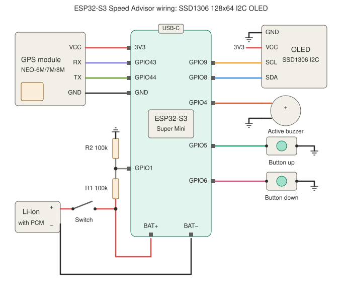
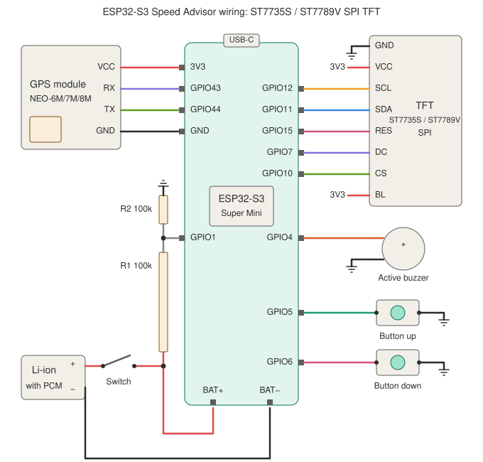
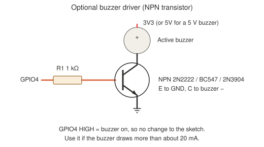
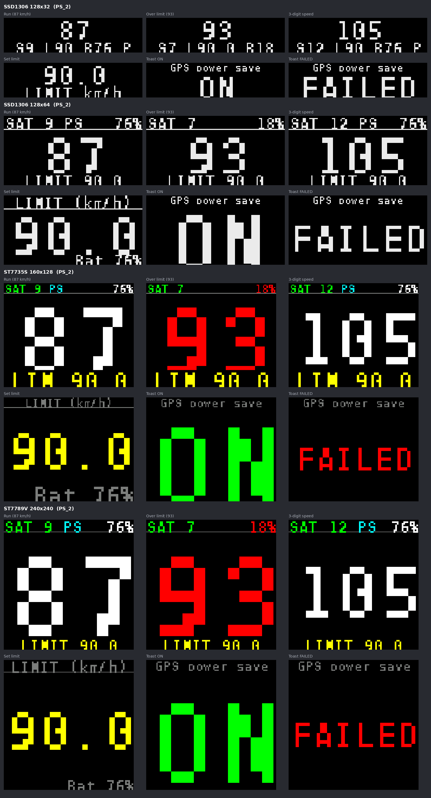

# ESP32-S3 Super Mini Speed Advisor

A compact GPS-based speed advisor that alerts you when a configurable speed threshold is exceeded.  
Designed for the ESP32-S3 Super Mini (or Zero-style boards), GY-NEO6MV2 / NEO-7MV2 / NEO-8MV2 GPS, active buzzer, and multiple display options.

## Features

- Configurable speed threshold (default 90.0 km/h, adjustable in 0.5 km/h steps with two buttons)
- Visual + audible alert when threshold is exceeded:
  - Short beep every second
  - After 45 s: increasing beep frequency
  - At 55 s: continuous tone
  - Display flashes in sync with the buzzer
- Live speed + number of GPS satellites on the display
- Bluetooth LE + Android web app: the same as the Wi-Fi page, while the phone keeps its mobile data
- Wi-Fi captive portal: a phone shows the live speed and the over-limit warning (flash, sound, vibration) and has the same settings as the buttons
- Battery level indication (requires external voltage divider on an ADC pin; the board's own charger handles charging)
- Support for multiple displays:
  - SSD1306 128×32 I2C
  - SSD1306 128×64 I2C (including GM009605-style modules)
  - ST7735S SPI
  - ST7789V SPI

## Versions

The current version is PS_6 (`SpeedAdvisor.ino`). Every version since PS_4, with a short description, is in [`versions/`](versions/).

## Disclaimer

**This is an unofficial hobby project.**  
It is provided “as is” without warranty of any kind. Use at your own risk.  
The author(s) are not responsible for any damage to equipment, vehicles, or persons resulting from the use or misuse of this software or hardware design.  
This device is **not** a certified speedometer, speed limiter, or safety system. Do not rely on it for legal speed compliance, navigation, or any safety-critical application.  
GPS accuracy depends on satellite visibility, antenna placement, and environmental conditions. Always obey traffic laws and drive responsibly.

## Credits

- GPS parsing: [TinyGPSPlus](https://github.com/mikalhart/TinyGPSPlus) by Mikal Hart
- OLED graphics: Adafruit SSD1306 & Adafruit GFX libraries
- TFT graphics: Adafruit ST7735 / ST7789 or TFT_eSPI (depending on configuration)
- ESP32 Arduino core by Espressif Systems
- Community pinout references for ESP32-S3 Super Mini / Zero boards

## Hardware Requirements

- ESP32-S3 Super Mini (or compatible Super Mini / Zero-style board)
- GY-NEO6MV2, NEO-7MV2 or NEO-8MV2 (u-blox NEO-6M / NEO-7M / NEO-8M) GPS module + antenna
- TMB12A03 active buzzer (3 V rated) or equivalent active buzzer
- One of the supported displays (see below)
- Two momentary push buttons
- Optional: Li-ion / LiPo battery + voltage divider for battery monitoring
- Wiring, breadboard or PCB, USB-C cable

### Recommended Pin Assignment (ESP32-S3 Super Mini)

| Function       | GPIO | Notes                                      |
|----------------|------|--------------------------------------------|
| GPS RX         | 44   | GPS TX → ESP RX (board label RX)           |
| GPS TX         | 43   | ESP TX → GPS RX (board label TX)           |
| Buzzer         | 4    | Active buzzer + pin (other pin to GND)     |
| Button Up      | 5    | Internal pull-up, other side to GND        |
| Button Down    | 6    | Internal pull-up, other side to GND        |
| I2C SDA        | 8    | For OLED                                   |
| I2C SCL        | 9    | For OLED                                   |
| Battery ADC    | 1    | Via voltage divider (see below)            |
| TFT MOSI       | 11   | SPI                                        |
| TFT SCK        | 12   | SPI                                        |
| TFT CS         | 10   | SPI                                        |
| TFT DC         | 7    | SPI                                        |
| TFT RST        | 15   | SPI                                        |
| TFT BL         | 13   | Optional: backlight dimming (PWM). Leave BL on 3V3 and set `TFT_BL_PIN` to -1 to disable |

**Always verify the silkscreen on your specific Super Mini board** — pin labels and available GPIOs can vary slightly between sellers.

### Wiring Diagrams

SSD1306 OLED (I2C):



ST7735S / ST7789V TFT (SPI):



Pin positions on the board are drawn to keep the wires straight and do not match the physical header order. Wire by GPIO number and check the silkscreen on your board. All ground symbols connect to the board GND.

### Buzzer Current Warning

> **Warning:** The buzzer is driven directly from GPIO4. A GPIO pin of the ESP32-S3 can only supply a limited current (about 40 mA absolute maximum, so keep the load well below 20 mA). Most small active buzzers such as the TMB12A03 are fine, but a larger or louder one can overload the pin and damage the board. Check the current rating in the datasheet. If it draws more than about 20 mA, drive it through an NPN transistor as shown below. No code change is needed, because GPIO4 HIGH still turns the buzzer on.



### Battery Charging

The ESP32-S3 Super Mini has a TP4054 Li-ion/LiPo charger on the board (about 100 mA charge current, 4.2 V). Solder the battery to the BAT+ and BAT− pads, not to the 5V pin. The board has no battery protection, so use a cell with a built-in protection circuit (PCM). Some clones differ, so check the underside of your board.

### Battery Voltage Monitoring

The Super Mini does not have a built-in battery sense pin. Connect a voltage divider from the battery positive to GPIO1 (and GND):

```
Battery+ ----[100kΩ]----+----[100kΩ]---- GND
                        |
                       GPIO1
```

(Or use 220kΩ / 220kΩ for lower current draw.)  
Adjust the `BATTERY_DIVIDER_RATIO` constant in the sketch if you use different resistors.  
Typical Li-ion range used: 3.0 V (0 %) – 4.2 V (100 %).

### Display Wiring Summary

- **SSD1306 I2C (128×32 or 128×64 / GM009605)**: VCC→3.3 V, GND→GND, SDA→GPIO8, SCL→GPIO9
- **ST7735S / ST7789V SPI**: VCC→3.3 V, GND→GND, MOSI→11, SCK→12, CS→10, DC→7, RST→15 (and BL to GPIO13 for backlight dimming, or to 3.3 V for a fixed backlight)

## Software Setup

### Arduino IDE Board Settings

1. Install the **ESP32** board package:
   - Tools → Board → Boards Manager
   - Search for **esp32**
   - Install **esp32 by Espressif Systems** (2.0.14 or newer, preferably latest 3.x)

2. Select the board:
   - **Tools → Board → esp32 → ESP32S3 Dev Module**
   - (There is no dedicated Super Mini entry — ESP32S3 Dev Module is correct)

3. Recommended Tools settings:

| Setting | Value | Notes |
|---------|-------|-------|
| USB CDC On Boot | Enabled | Serial works over USB-C |
| USB Mode | Hardware CDC and JTAG | Default is fine |
| CPU Frequency | 240 MHz | Default |
| Flash Size | 4MB (32Mb) | Most Super Minis |
| Partition Scheme | Huge APP (3MB No OTA/1MB SPIFFS) | Needed with Wi-Fi and Bluetooth both on; the default scheme is too small |
| PSRAM | OPI PSRAM | Enable if your board has PSRAM |
| Upload Speed | 921600 | Lower to 460800 if upload fails |
| Core Debug Level | None | |

4. Connect the board and select the correct port under **Tools → Port**.

5. Install libraries via **Tools → Manage Libraries**:
   - TinyGPSPlus
   - Adafruit SSD1306
   - Adafruit GFX Library
   - Adafruit ST7735 and ST7789 Library
   - NimBLE-Arduino (by h2zero, 2.x recommended) — for Bluetooth; not needed if `BLE_ENABLE` is 0

6. Open `SpeedAdvisor.ino`. All four display drivers are built in, and the display type is chosen on the device (see **Selecting the display type** below). `DISPLAY_TYPE` at the top of the sketch is only the type used on the very first start:
   ```cpp
   #define DISPLAY_TYPE 3   // 0 = SSD1306 128x32
                            // 1 = SSD1306 128x64 (GM009605)
                            // 2 = ST7735S
                            // 3 = ST7789V
   ```

   For the TFT displays, also check these settings near the top of the sketch:

   | Setting | Display | Meaning |
   |---------|---------|---------|
   | `ST7789_WIDTH` / `ST7789_HEIGHT` | ST7789V | Panel size: 240×240 (1.3" / 1.54"), 240×320 (2.0" / 2.4"), 135×240 (1.14"), 170×320 (1.9") |
   | `ST7789_SPI_MODE` | ST7789V | `SPI_MODE0` for most modules. For 240×240 modules without a CS pin, set `TFT_CS` to -1 and use `SPI_MODE3` |
   | `ST7735_TAB` | ST7735S | Panel variant: `INITR_BLACKTAB` (default), `INITR_GREENTAB`, `INITR_REDTAB`, `INITR_MINI160x80`. Try another one if red and blue are swapped or there is a noisy stripe at one edge |
   | `TFT_ROTATION` | both | 1 = landscape, 3 = landscape turned 180° |

   The TFT layout scales to the panel resolution. Only the parts of the screen that change are redrawn, so the speed does not flicker. The speed turns red above the limit.

7. Upload.

**Upload tip:** If the board does not enter download mode automatically, hold the **BOOT** button, press and release **RESET** (or unplug/replug), then release **BOOT** and click Upload.

After upload, open the Serial Monitor at **115200 baud** (with USB CDC On Boot enabled).

### Serial Monitor output

With `DEBUG_SERIAL` set to 1 (the default), the sketch prints one status line per second:

```
chars:15234  fix:yes  sats:8  speed:0.4 km/h  limit:90.0  bat:87%  alert:off
```

- `chars` stays at 0: no data from the GPS. Check that GPS TX goes to the board RX pin and that the baud rate is 9600.
- `chars` increases but `fix:no`: the GPS works but has no fix yet. Move it near a window or outside; a cold start can take 1–5 minutes.
- `fix:yes` with 4 or more satellites: working. A speed of 0–2 km/h while standing still is normal GPS noise.
- `bat:0%`: the battery divider on GPIO1 is not connected (fine when powered from USB).

You may also see `TFT 240x240 ready` at startup (easy to miss, because it is printed before the Serial Monitor reconnects) and `GPS power save ON: acknowledged` when power save is switched. Set `DEBUG_SERIAL` to 0 to turn the status line off.

## Wiring Diagram (Text)

```
ESP32-S3 Super Mini
┌─────────────────────────┐
│ 5V  3V3  GND            │
│                         │
│ GPIO44 ← GPS TX         │
│ GPIO43 → GPS RX         │
│ GPIO4  → Buzzer +       │
│ GPIO5  ← Button Up      │
│ GPIO6  ← Button Down    │
│ GPIO8  ↔ OLED SDA       │
│ GPIO9  ↔ OLED SCL       │
│ GPIO1  ← Battery divider│
│                         │
│ (SPI pins for TFT)      │
└─────────────────────────┘

GPS GY-NEO6MV2 / NEO-7MV2 / NEO-8MV2
VCC → 3.3V or 5V (module has regulator)
GND → GND
TX  → ESP GPIO44
RX  → ESP GPIO43
(Default baud 9600 — change GPS_BAUD in the sketch if needed)

Buzzer TMB12A03 (active)
+ → GPIO4
- → GND

Buttons (momentary)
One side → GPIO5 / GPIO6
Other side → GND
(internal pull-ups enabled in code)

Battery divider (optional)
Bat+ --[100k]--+--[100k]-- GND
               |
              GPIO1
```

Adjust pins in the sketch if your Super Mini silkscreen differs.

## Usage

1. Power on. The display shows the threshold speed (starts at 90.0 km/h).
2. Use the two buttons to increase/decrease the threshold in 0.5 km/h steps.
3. After a short idle period (or button confirmation), the device switches to normal mode.
   A short press changes the limit by one step (Up = +0.5 km/h, Down = -0.5 km/h).
   **Long press Up (about 0.8 s): cycle the display brightness** (3 levels, then back to the first). On the TFT versions this needs the BL pin wired to GPIO13.
   **Long press Down (about 0.8 s, acted on when you release it): switch the GPS power save on or off.** The display confirms with "GPS power save ON / OFF" (or "FAILED" if the module does not answer), and "PS" is shown on the main screen while it is on. The setting is remembered after power-off.
   **Hold Down and short press Up: next display type** (see below).
4. Normal mode shows current GPS speed and satellite count (plus battery percentage).
5. When speed exceeds the threshold, the buzzer and display flash according to the timing rules above.
6. Speed must drop below the threshold to reset the alert timer.

## Phone portal (Wi-Fi)

The board opens its own Wi-Fi network. No router or internet is needed.

1. On the phone, connect to the Wi-Fi network **SpeedAdvisor** (password **speedadv**).
2. The page opens by itself as a "sign in to network" page. If it does not, open **http://192.168.4.1** in the browser.
3. The page shows:
   - the live speed (big), satellites, power save and battery
   - the limit, with − / + buttons (0.5 km/h steps) and a box to type an exact value
   - brightness Low / Mid / High (same as long press Up)
   - GPS power save ON / OFF (same as long press Down)
   - display type OLED 128x32 / OLED 128x64 / ST7735 / ST7789 (same as hold Down + press Up)
   - **Sound ON/OFF** for the phone alert
4. Above the limit the speed turns red, "SLOW DOWN" appears and the screen flashes in the same rhythm as the buzzer (faster after 45 s, steady after 55 s). The phone vibrates too (Android). Tap **Sound ON** once to let the phone beep as well; browsers only allow sound after a tap.

Notes:

- The phone will say the network has no internet. Choose to stay connected (Android: "Keep Wi-Fi connection"; iPhone: Cancel → "Use Without Internet"). Mobile data may be paused while connected.
- The iPhone sign-in window may not allow sound. Open http://192.168.4.1 in Safari instead.
- A limit changed from the phone shows on the device's set screen for 5 s, like a button press.
- To save battery, Wi-Fi switches off after `PORTAL_IDLE_OFF_MIN` minutes (default 10) with no phone connected; the display shows "Wi-Fi portal OFF". Power-cycle the board to turn it on again. Set it to 0 to keep Wi-Fi always on.
- Settings at the top of the sketch: `PORTAL_ENABLE` (0 = no Wi-Fi at all), `PORTAL_SSID`, `PORTAL_PASS` (8+ characters, or `""` for an open network), `PORTAL_TX_POWER`.
- No extra libraries: `WiFi`, `WebServer` and `DNSServer` come with the ESP32 board package.

## Android app (Bluetooth)

The board also talks Bluetooth LE. The app is a web app in [`docs/app/`](docs/app/): Chrome on Android connects to the board directly over Bluetooth (Web Bluetooth). It does everything the Wi-Fi page does: live speed, the over-limit warning (flash, sound, vibration) and all the settings, including the display type. The phone stays on its normal mobile data.

**Publishing the app (once):** on GitHub open the repository **Settings → Pages**, choose **Deploy from a branch**, branch **main**, folder **/docs**, and save. After a minute the app is at:

**https://claudiu1975.github.io/ESP32-S3-Speed-Advisor/app/**

**Installing on the phone:**

1. Open that address in **Chrome** on Android.
2. Chrome menu (⋮) → **Add to Home screen** → **Install**. The app gets its own icon and opens full screen. After the first visit it also works without internet.
3. Turn on Bluetooth (and Location, which Android needs for Bluetooth scanning).

**Using it:**

1. Tap **Connect** and choose **SpeedAdvisor** in the list. The first time, allow Chrome to use Bluetooth.
2. The app shows the speed, satellites, battery and all the settings. Tap **Sound ON** once if the phone should beep too.
3. If the connection drops (out of range, board restarted), the app reconnects by itself. Tap **Disconnect** to stop.
4. While connected the screen stays on.

Notes:

- Android + Chrome only. iPhone Safari and Firefox have no Web Bluetooth.
- Keep the app in the foreground. Android slows down pages in the background, so the warning sound may stop.
- Bluetooth and the Wi-Fi portal work at the same time. To leave one out, set `BLE_ENABLE` or `PORTAL_ENABLE` to 0 at the top of the sketch.
- Bluetooth uses far less power than Wi-Fi (estimated 5–15 mA extra instead of 60–100 mA), so it stays on all the time. Not measured.
- The protocol (one service, a 12-byte status notification and 1–3 byte commands) is described in the sketch, above `bleStart()`, if you want to use another BLE app.

## Selecting the display type

Hold the **Down** button and short press **Up**. Each press of Up moves to the next type: OLED 128x32 → OLED 128x64 → ST7735 → ST7789 → back to the start. The new type is confirmed with "Display" and its name, and it is remembered after power-off. Releasing Down afterwards does nothing.

With the wrong type selected the screen stays blank or shows garbage, so just keep pressing Up (with Down held) until the picture is right. The type can also be chosen on the phone page (see Phone portal) or in the Android app.

The panel details of the TFTs (`ST7789_WIDTH` / `ST7789_HEIGHT`, `ST7789_SPI_MODE`, `ST7735_TAB`, `TFT_ROTATION`) are still set in the sketch.

## Power saving

The sketch is tuned to save battery:

- The CPU runs at 80 MHz (`CPU_FREQ_MHZ`) instead of the default 240 MHz.
- The display is redrawn only when something visible changes, not on every loop.
- The battery voltage is sampled once per second.
- The display brightness can be lowered with a long press of Up (see Usage). On the TFT, the backlight is the biggest display load, so dimming it helps the most.

The GPS module is the largest consumer. By default it runs at full performance. Switch on **GPS power save** with a long press of the Down button: the sketch sends the u-blox command `UBX-CFG-RXM` (low-power mode) and waits for the module's acknowledgement. In the u-blox NEO-6 datasheet, power save mode at 1 Hz uses about half the power of continuous mode (51 mW against 115 mW at 3.0 V) while still giving one update per second.

Notes:

- The setting `GPS_PS_LPMODE` chooses the mode used when power save is on: `1` = Power Save Mode (default), `4` = Eco mode.
- Some cheap GY-NEO6MV2 boards carry clone chips that ignore the command. In that case the display shows "FAILED" and nothing changes.
- With a weak signal the receiver stays awake longer, so the saving is smaller and the speed may be slightly less accurate. Test it on a real drive before relying on it.
- The GPS TX line (GPIO43 to the module's RX) must be connected, because the command is sent over it.

### Estimated runtime on a 1800 mAh battery

Estimates, not measurements. Realistic runtime in hours, using 85 % of the capacity (1530 mAh), with GPS power save off or on and the display at full, medium or lowest brightness (long press Up cycles the levels):

| Display | PS off, full | PS off, medium | PS off, lowest | PS on, full | PS on, medium | PS on, lowest |
|---------|------|------|------|------|------|------|
| SSD1306 128x32 | 19 h | 19 h | 19 h | 25 h | 25 h | 26 h |
| SSD1306 128x64 | 17 h | 18 h | 19 h | 22 h | 23 h | 25 h |
| ST7735S | 15 h | 18 h | 19 h | 19 h | 23 h | 25 h |
| ST7789V | 12 h | 15 h | 17 h | 15 h | 19 h | 22 h |

- The table is for Wi-Fi off. While the portal is on, the ESP32 draws roughly 60–100 mA more, so with a phone connected all the time expect about half the runtime. With nobody connected, Wi-Fi turns itself off after 10 minutes (see Phone portal).
- GPS power save adds about 2 to 6 hours at full brightness (6.0 h on the 128x32, 4.9 h on the 128x64, 3.9 h on the ST7735S, 2.4 h on the ST7789V), provided your module accepts the command.
- Dimming helps mostly on the TFT versions, where the backlight is the biggest display load (about 5 h on the ST7789V from full to lowest). On the OLEDs the gain is small.
- Assumptions (ESP32 27 mA, GPS 45 mA or 25 mA with power save, buzzer 5 minutes per hour) and the formula are in [docs/BATTERY_LIFE.md](docs/BATTERY_LIFE.md). The same calculation as a spreadsheet with live formulas is [docs/Battery_Life_1800mAh.xlsx](docs/Battery_Life_1800mAh.xlsx): change the inputs to match your battery and modules.

## Battery life

A calculation of the runtime on a 1800 mAh battery, with GPS power save on or off and at three brightness levels, is in [docs/BATTERY_LIFE.md](docs/BATTERY_LIFE.md).

## Display layout

The run screen uses the same layout on all four displays: a top line (satellites, power save, battery), the speed filling the space in the middle, and the limit on the bottom line. The top and bottom text is drawn 1.5 times larger than the built-in font allows in whole steps, using fractional scaling. The preview below is rendered from the sketch's own drawing code with a stand-in font, so glyph shapes differ slightly from the real display.



## License

MIT License – see LICENSE file.

## Contributing

Issues and pull requests are welcome. Please test on real hardware before submitting display or pin changes.
